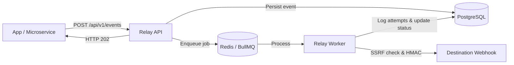

# Relay

A reliable, developer-first webhook delivery platform built with Next.js 16, TypeScript, PostgreSQL, and BullMQ.

Relay handles asynchronous fan-out, cryptographic HMAC-SHA256 signatures, exponential backoff retries with full jitter, and SSRF prevention—so your application can send webhooks reliably without blocking requests or losing events.

---

## Features

- **At-least-once delivery**: Every event is persisted in PostgreSQL and queued in Redis/BullMQ.
- **HMAC-SHA256 signatures**: Outgoing requests include standard `Relay-Signature` (`t=...,v1=...`) with timestamp drift validation.
- **Exponential backoff with jitter**: Smart retries for transient errors (5xx, 429, timeouts) while failing fast on permanent errors (4xx).
- **SSRF & DNS rebinding protection**: Blocks loopback, private networks (RFC 1918), and cloud metadata (`169.254.169.254`).
- **Idempotency keys**: Safely retry event ingestion with `Idempotency-Key` headers without duplicate deliveries.
- **Developer dashboard**: Real-time attempt logs, latency tracking, payload inspection, and manual retry triggers.
- **Multi-project support**: Separate endpoints, API keys, and event streams across different environments or projects.

---

## Quickstart

### 1. Clone & install

```bash
git clone https://github.com/your-username/relay-app.git
cd relay-app
pnpm install
```

### 2. Configure environment

```bash
cp .env.example .env
```

Ensure your PostgreSQL and Redis instances are running (e.g. via Docker):

```bash
docker compose up -d
```

### 3. Run database migrations

```bash
pnpm db:generate
pnpm db:migrate
```

### 4. Start the application

Run the Next.js web application and the background delivery worker:

```bash
# Terminal 1: Web dashboard & API
pnpm dev

# Terminal 2: Background delivery worker
pnpm worker
```

Open [http://localhost:3000](http://localhost:3000) to access the dashboard.

---

## Quick Usage

### 1. Ingest an event

```bash
curl -X POST http://localhost:3000/api/v1/events \
  -H "Authorization: Bearer rel_live_..." \
  -H "Content-Type: application/json" \
  -H "Idempotency-Key: evt_order_1001" \
  -d '{
    "type": "order.completed",
    "data": {
      "orderId": "ord_1001",
      "amount": 4900,
      "currency": "USD"
    }
  }'
```

### 2. Verify webhook signatures (Node.js receiver)

```typescript
import crypto from "node:crypto";

export function verifyWebhookSignature(
  payload: string,
  signatureHeader: string,
  secret: string
): boolean {
  const parts = Object.fromEntries(
    signatureHeader.split(",").map((p) => p.split("="))
  );
  
  const signed = `${parts.t}.${payload}`;
  const expected = crypto
    .createHmac("sha256", secret)
    .update(signed)
    .digest("hex");

  return crypto.timingSafeEqual(
    Buffer.from(parts.v1, "hex"),
    Buffer.from(expected, "hex")
  );
}
```

---

## How It Works



---

## Scripts

| Command | Description |
| --- | --- |
| `pnpm dev` | Start Next.js development server on port 3000 |
| `pnpm worker` | Start BullMQ webhook delivery worker |
| `pnpm mock-receiver` | Start local mock webhook receiver for testing |
| `pnpm build` | Build Next.js production bundle |
| `pnpm start` | Start production Next.js server |
| `pnpm db:generate` | Generate Drizzle migration files |
| `pnpm db:migrate` | Apply database migrations |
| `pnpm db:studio` | Open Drizzle Studio visual database inspector |
| `pnpm test` | Run test suite with Vitest |

---

## Testing

```bash
# Run unit & integration tests
pnpm test

# Run tests in watch mode
pnpm test:watch
```

---

## License

[MIT](LICENSE)
