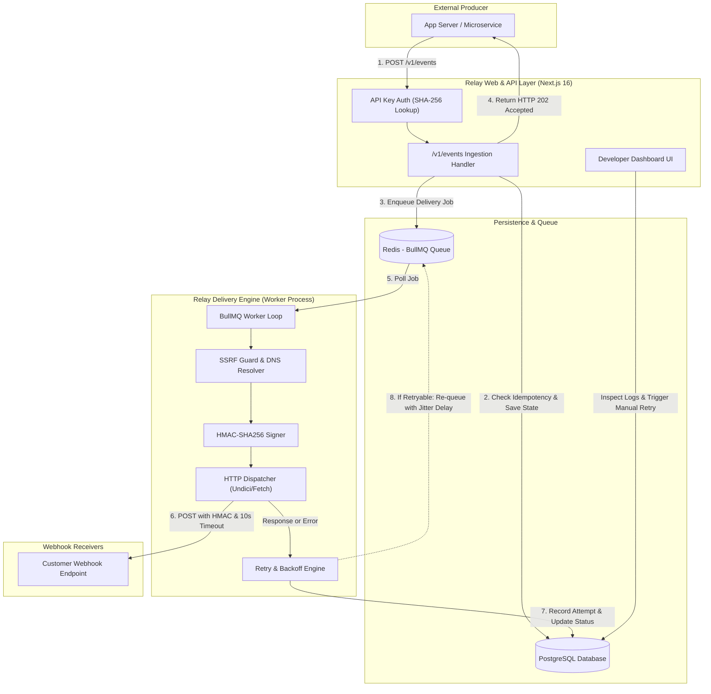
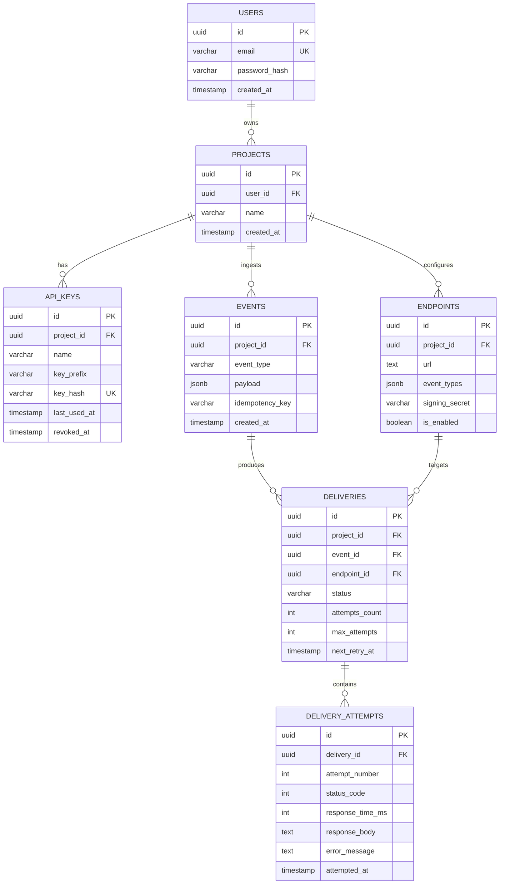

# Relay — Reliable Webhook Delivery Platform

> A resilient, developer-focused webhook delivery and retry engine engineered with **Next.js 16**, **TypeScript**, **PostgreSQL**, **Drizzle ORM**, **BullMQ**, and **Redis**.

[]()
[]()
[]()
[]()
[]()

---

## 1. System Overview

**Relay** decouples event submission from webhook delivery. Rather than having client backends block HTTP requests or drop failed deliveries, Relay accepts events, validates and persists them idempotently, schedules them into an asynchronous BullMQ queue, and delivers payloads to registered destination endpoints with:

- **At-Least-Once Delivery Guarantees:** Persistent state stored in PostgreSQL as the single source of truth.
- **SSRF & DNS Rebinding Defenses:** Strict rejection of private IP spaces (`127.0.0.1`, RFC 1918, AWS/GCP metadata `169.254.169.254`, `::1`) both at registration and pre-socket DNS resolution time.
- **Outgoing HMAC-SHA256 Signatures:** Standard Stripe/Svix format (`Relay-Signature: t=...,v1=...`) with timestamp drift verification.
- **Resilient Exponential Backoff with Full Jitter:** Prevents thundering herds against recovering customer services.
- **Auditable Delivery Logs & Manual Retries:** Granular latency, status code, and truncated response bodies visible via a real-time developer dashboard.

---

## 2. High-Level Architecture



---

## 3. Relational Data Model (PostgreSQL + Drizzle)



---

## 4. Key Engineering Highlights & Security Defenses

### 4.1 Server-Side Request Forgery (SSRF) Defense
Arbitrary webhook endpoints introduce critical SSRF risks. Relay employs a multi-stage defense:
1. **Syntactic & Hostname Validation:**
   - Prohibits non-HTTP/HTTPS protocols (`file:`, `gopher:`, `ftp:`).
   - Rejects embedded user credentials (`user:pass@host`).
   - Blocks reserved local domains (`localhost`, `.local`, `.internal`, `.lan`, `.corp`).
2. **Pre-Flight DNS Resolution & Rebinding Mitigation:**
   - Prior to opening a TCP socket, `resolveAndValidateDestination()` resolves both IPv4 and IPv6 records.
   - Evaluates all returned addresses against private CIDR blocks (`127.0.0.0/8`, `10.0.0.0/8`, `172.16.0.0/12`, `192.168.0.0/16`, AWS/GCP metadata `169.254.169.254`, `::1`, `fc00::/7`).
   - If ANY IP is non-public, the dispatch is aborted without sending the request.
3. **Redirect Blocking:**
   - Outgoing requests use `redirect: 'manual'` to prevent redirect hopping into private subnets.

### 4.2 Outgoing HMAC-SHA256 Signatures
- Header: `Relay-Signature: t=<timestamp>,v1=<signature>`
- Input string: `${t}.${rawJsonPayload}`
- Signature: `HMAC_SHA256(endpoint.signing_secret, input)`
- Receiving endpoints verify constant-time equality and enforce a 5-minute clock skew window to mitigate replay attacks.

### 4.3 Exponential Backoff with Full Jitter
To prevent the "thundering herd" problem against struggling customer backends:
$$\text{delay} = \text{random}(0, \min(\text{cap}, \text{base} \times 2^{\text{attempt} - 1}))$$
- **Base delay:** 15 seconds
- **Max cap:** 1 hour (3600s)
- **Error classification:**
  - `2xx`: Success
  - `400, 401, 403, 404, 422`: Permanent client error (marked `failed` immediately).
  - `408, 429, 5xx`, network timeouts: Retryable transient error.

---

## 5. API Reference

### Event Ingestion
`POST /api/v1/events`

#### Headers
```http
Authorization: Bearer rel_live_...
Content-Type: application/json
Idempotency-Key: ord_create_client_9942
```

#### Request Body (JSON, max 256 KB)
```json
{
  "type": "order.created",
  "data": {
    "orderId": "123",
    "customer": {
      "email": "customer@example.com"
    },
    "total": 499
  }
}
```

#### Response (`HTTP 202 Accepted`)
```json
{
  "id": "019283a1-7c42-7890-a1b2-c3d4e5f60001",
  "type": "order.created",
  "created_at": "2026-10-13T16:45:00.000Z",
  "deliveries": [
    {
      "id": "019283a1-7c42-7890-a1b2-c3d4e5f60002",
      "endpoint_id": "019283a1-7c42-7890-a1b2-c3d4e5f60003",
      "status": "pending"
    }
  ]
}
```

---

## 6. Local Quickstart

### Prerequisites
- Node.js `20+`
- `pnpm` (run via `fish -c "pnpm ..."` or native `pnpm`)
- Docker & Docker Compose (optional, for local PostgreSQL and Redis)

### Step 1: Clone & Install Dependencies
```bash
git clone https://github.com/your-username/relay-app.git
cd relay-app
fish -c "pnpm install"
```

### Step 2: Configure Environment Variables
Copy `.env.example` to `.env`:
```bash
cp .env.example .env
```

### Step 3: Start Local PostgreSQL & Redis
```bash
docker compose up -d
```
*(Alternatively, configure your cloud PostgreSQL like Neon/Supabase and Redis like Upstash in `.env`)*

### Step 4: Run Database Migrations
```bash
fish -c "pnpm db:generate"
fish -c "pnpm db:migrate"
```

### Step 5: Start the Web Dashboard & API
```bash
fish -c "pnpm dev"
```
Open **[http://localhost:3000](http://localhost:3000)** in your browser.

### Step 6: Start the Background Delivery Worker
In a separate terminal:
```bash
fish -c "pnpm worker"
```

### Step 7: (Optional) Start the Interactive Mock Webhook Receiver
In a third terminal, run our built-in test receiver to watch live webhook dispatches:
```bash
fish -c "pnpm mock-receiver"
```

---

## 7. Automated Testing Suite

Relay includes comprehensive unit and integration tests using **Vitest**:

```bash
# Run all tests
fish -c "pnpm test"

# Run tests in watch mode
fish -c "pnpm test:watch"
```

### Test Coverage Highlights:
- **`tests/unit/ssrf.test.ts`**: Private IP detection (IPv4, IPv6, cloud metadata `169.254.169.254`), domain TLD restrictions.
- **`tests/unit/crypto.test.ts`**: API key hashing, HMAC-SHA256 signing, timestamp drift tolerance, constant-time comparisons.
- **`tests/unit/policy.test.ts`**: HTTP status code classification (2xx vs 4xx vs 5xx), backoff math with jitter.
- **`tests/unit/matcher.test.ts`**: Event type pattern matching (`order.*`, `*`, exact).
- **`tests/integration/ingest.test.ts`**: Ingestion payload boundaries and Zod validation.

---

## 8. Engineering Trade-offs & Limitations

1. **At-Least-Once vs Exactly-Once:**
   HTTP webhooks cannot guarantee distributed exactly-once delivery due to network drops between endpoint processing and HTTP response acknowledgment. Relay guarantees **at-least-once delivery** and provides unique delivery IDs and timestamps for consumer-side idempotency.
2. **Immediate Enqueue with Sweeper vs Transactional Outbox CDC:**
   Rather than introducing Debezium or Kafka for Change Data Capture (CDC), Relay commits event state to PostgreSQL first and then enqueues to BullMQ. A background reconciliation sweeper runs every 60 seconds to catch any un-enqueued or overdue deliveries.
3. **Standalone Worker vs In-Process Next.js Dispatch:**
   The background delivery worker runs as an isolated Node daemon (`src/worker/index.ts`). Slow, timed-out, or hanging third-party webhook requests never saturate Next.js event loops or impact dashboard latency.
